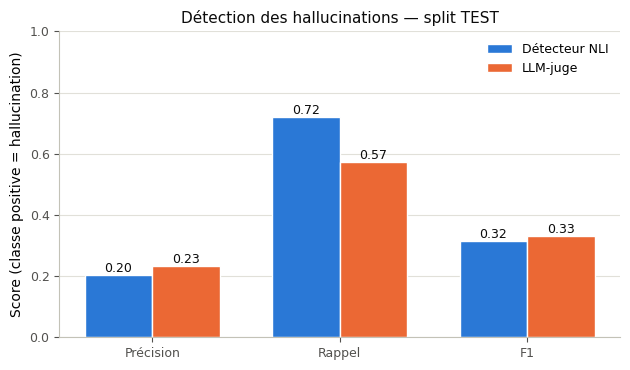
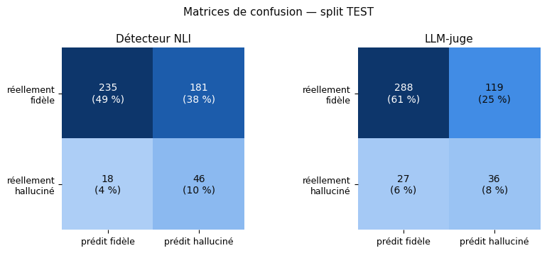
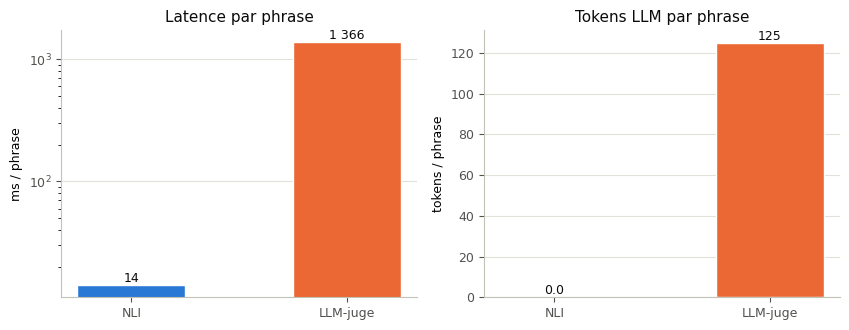
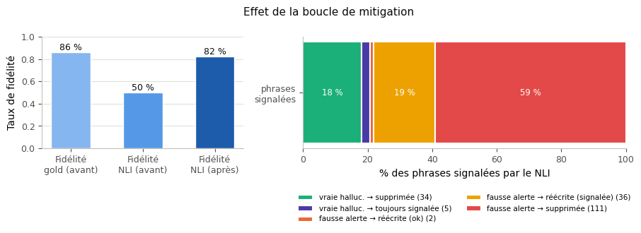

# Hallucination Detection & Mitigation in RAG Systems

**A complete Retrieval-Augmented Generation pipeline with a sentence-level hallucination guard — racing a 184M-parameter NLI verifier against a 3B LLM-as-a-judge on the RAGTruth benchmark, then repairing flagged answers with a constrained-regeneration loop.**


**Author:** Mazen Ben Brahim — individual project
**Context:** Advanced NLP/LLM university course — Topic n°15 *“Hallucination Detection and Mitigation in RAG”* (advanced track), supervised by Mme Tasnim Hamdeni
**Notebook language:** French (course requirement) · **This README:** English

> 📓 [**`projet_rag_hallucination.ipynb`**](projet_rag_hallucination.ipynb) — the full annotated notebook, runs top-to-bottom on a free Google Colab T4 in **≈ 40–50 min**.

---

## TL;DR — what this project demonstrates

| Finding | Evidence |
|---|---|
| A **184M NLI encoder detects RAG hallucinations at the same F1 as a 3B LLM-judge** — while being **≈ 96× faster** and consuming **zero LLM tokens** | F1 0.32 vs 0.33 · 14 ms vs 1,366 ms per sentence · 0 vs ~125 tokens per sentence (TEST split, n = 480) |
| The two detectors **disagree more than expected** (Cohen's κ = 0.16) — they catch *different* hallucinations, which is the strongest argument for an ensemble | 74 sentences caught only by NLI, 119 only by the judge, 72 missed by both |
| A **constrained-regeneration loop** raises NLI-measured faithfulness from **49.9% → 82.2%** of surviving sentences in a single pass — and its gold-aware taxonomy exposes the real trade-off: deletions vs corrections vs false alerts | 188 flagged sentences → 145 deleted, 43 rewritten, each re-verified by NLI + judge second opinion |
| Every result is **reproducible and pre-registered**: thresholds calibrated on a DEV split only, hypotheses fixed before running, one seed, full version archive, complete compute budget | 308 LLM calls · 209,183 tokens · ≈ 21 min GPU — **no paid APIs**, everything runs locally |

---

## 1. The problem

RAG was supposed to ground LLM answers in retrieved sources. In practice, generators still assert things their own passages never said — that is a **hallucination** in the verifiability sense: *a claim not supported by the provided sources*, regardless of whether it happens to be true in the world. This is the failure mode that matters for traceable systems in medicine, law, or education.

The industry-default guard is an **LLM-as-a-judge**: ask another LLM to re-read each answer and flag unsupported claims. It works, but it is expensive (one generation per judged answer), slow, prompt-sensitive, and hard to explain. This project tests a cheaper hypothesis end-to-end:

> **Can a small Natural Language Inference model — a 184M encoder, 16× smaller than the LLM — match an LLM-judge on hallucination detection at a fraction of the cost, and can its output drive an automated repair loop?**

Four research questions (RQ1–RQ4) and four **falsifiable hypotheses (H1–H4) were written down before any experiment ran** (notebook §1.4, §3.4).

---

## 2. System architecture

```
 User question ──► FAISS retrieval (top-k passages) ──► LLM generation (RAG answer)
                                                                  │
                                                                  ▼
                    ┌─────────────────────────────────────────────┴────────────┐
                    │   DETECTION — sentence by sentence, two methods raced:  │
                    │   1) NLI detector (DeBERTa-v3, 184M)  2) LLM-judge (3B) │
                    └──────────────────────────────┬──────────────────────────┘
                                                   ▼
             MITIGATION — constrained regeneration of flagged sentences
             (rewrite strictly from the passages — or output DELETE)
                                                   ▼
           Re-verification (NLI + judge second opinion) & before/after evaluation
```

| Component | Model | Why this choice |
|---|---|---|
| Embeddings | `all-MiniLM-L6-v2` (22M, 384-dim) + FAISS `IndexFlatIP` | Fast standard for English retrieval; exact inner-product search is the right tool at ~10³ docs |
| NLI detector | `MoritzLaurer/DeBERTa-v3-base-mnli-fever-anli` (184M) | DeBERTa-v3 fine-tuned on **MNLI + FEVER + ANLI** — FEVER is literally fact verification against documents, i.e. this task |
| Generator & judge | `Qwen/Qwen2.5-3B-Instruct` (3.09B, fp16) | Apache-2.0 with no gated access; fits a free Colab T4; one model plays three roles (generator, judge, rewriter) — a deliberate frugality choice whose bias is measured, not ignored |

---

## 3. Dataset — RAGTruth, with span-level ground truth

[RAGTruth](https://github.com/ParticleMedia/RAGTruth) (Niu et al., ACL 2024) is the reference corpus for this problem: **17,790 RAG answers from 6 real LLMs** (GPT-4, GPT-3.5, Mistral-7B, Llama-2-7B/13B/70B), **manually annotated at the span level** — every hallucinated fragment has character offsets and a type. It was selected over HaluEval and simulated SQuAD precisely because its hallucinations are *natural* and *localized* (justification table in notebook §3.1). Loaded from the public MIT-licensed mirror [`wandb/RAGTruth-processed`](https://huggingface.co/datasets/wandb/RAGTruth-processed).

**Cohort construction (notebook §3.2–3.4):**

- Filtered to the **QA task** (MS MARCO questions + web passages), quality = `good` → 5,767 answers, 29.6% containing ≥ 1 hallucinated span
- Span types in the pool: *Evident Baseless Info* (1,534) ≫ *Subtle Baseless Info* (881) > *Evident Conflict* (411) > *Subtle Conflict* (49) — the corpus is dominated by **added, unsupported information**, the hardest case for entailment-based detection
- **Stratified sample of 100 answers (50 with / 50 without hallucinations)**, seed-fixed → **696 sentences** after segmentation (194 non-assertive list markers filtered out), of which 96 gold-hallucinated
- Span → sentence projection by any-overlap rule; each answer averages 7.0 sentences
- **Response-level DEV/TEST split (30/70)** — all sentences of one answer stay in the same side, so style and topic cannot leak across the split

A methodological point that makes the evaluation sound: RAGTruth's gold labels mean *“unsupported by the answer's own context”* — **exactly** the definition both detectors use, so the comparison to gold is well-founded.

---

## 4. The two detectors and the repair loop

### 4.1 NLI detector (notebook §4.2)

Every sentence (hypothesis) is scored against every retrieved passage (premise) by the DeBERTa NLI model — **2,088 sentence × passage pairs scored in 9.9 s**. Aggregation is *max over passages*: a sentence is supported if **at least one** passage entails it.

- Sentence is flagged ⟺ `max_entailment < τ_ent` **or** `max_contradiction > τ_contra`
- **(τ_ent, τ_contra) = (0.55, 0.50), chosen by grid search maximizing F1 on the DEV split only** — never on TEST, so reported metrics are not optimistic by construction
- Labels are read **by name** from `model.config.id2label`, not by index — NLI checkpoints permute label order, a classic silent-failure trap (see §8)

### 4.2 LLM-judge baseline (notebook §4.3)

One **greedy-decoded** (deterministic) LLM call judges all numbered sentences of an answer against the passages, in a strict line format `S<id> | SUPPORTED / NOT_SUPPORTED | <short justification>`. The justification acts as lightweight chain-of-thought; a regex parser with **one bounded re-ask** recovers malformed output — 13 of 696 sentences (1.9%) remained unparsed and are transparently excluded from the judge's metrics only.

### 4.3 Mitigation loop — constrained regeneration (notebook §4.4)

Each NLI-flagged sentence is sent to the LLM with one instruction: **rewrite it so every fact is supported by the passages, changing as little as possible — or output `DELETE`** if nothing can support it. The answer is rebuilt, and every rewritten sentence is re-scored by the NLI detector **and** re-judged by the LLM (second opinion), because gold labels don't exist for freshly generated text. The self-verification bias this creates is explicitly measured and discussed rather than hidden.

---

## 5. Results (all metrics on the held-out TEST split)

### 5.1 Detection quality — parity at two orders of magnitude less cost

| Detector | Precision | Recall | F1 | Latency / sentence | LLM tokens / sentence |
|---|---:|---:|---:|---:|---:|
| **NLI (DeBERTa-v3, 184M)** | 0.20 | **0.72** | 0.32 | **14 ms** | **0** |
| **LLM-judge (Qwen2.5-3B)** | 0.23 | 0.57 | 0.33 | 1,366 ms | ~125 |

*Precision/recall/F1 on the TEST split (n = 480; judge n = 470 after excluding 13 unparsed sentences); per-sentence cost measured across the full 696-sentence evaluation sample, as reported in the notebook.*

<p align="center"></p>

<p align="center"></p>

**Reading the error profiles (not just the F1):** the NLI detector is a **high-recall / low-precision screen** — it catches 72% of true hallucinations but over-flags, which is the right profile for a cheap first filter feeding a repair loop. The judge is more conservative on both sides. A 3B-parameter model buying **no measurable F1** over a 184M encoder is the cost-quality story of this project:

<p align="center"></p>

### 5.2 Do the two detectors see the same hallucinations? No — and that's the finding

- Raw agreement 58.9%, but **Cohen's κ = 0.158** (chance-corrected — raw agreement is misleading on a 13% positive class)
- Of 470 jointly scored sentences: **74 right only by the NLI, 119 right only by the judge, 72 missed by both**
- Qualitative pattern (auto-extracted in notebook §6.1): the judge catches *pragmatic nonsense* the NLI scores as “neutral”; the NLI's entailment head catches *unsupported specifics* the judge skims over — and the failure modes are just as instructive, e.g. a gold-**faithful** sentence about hydrogen-peroxide doses flagged by NLI's contradiction head (score 1.00) that the judge correctly passed

Hypothesis H2 had predicted κ ∈ [0.30, 0.60]; the measured 0.16 **falsified it**. The project treats that as a result: the detectors are *complementary, not redundant* — the strongest empirical argument for the NLI-first + judge-on-borderline ensemble proposed in §7.

### 5.3 Mitigation — one pass, quantified honestly

On 50 TEST answers (375 sentences, 188 NLI-flagged), a single mitigation pass produced:

| Outcome | Count | Share of flagged |
|---|---:|---:|
| Kept (not flagged) | 187 | — |
| **Deleted** (nothing in the passages could support the sentence) | **145** | 77% |
| **Rewritten** — of which 46.5% judged supported by the LLM second opinion | **43** | 23% |

- NLI-flagged faithfulness: **49.9% → 82.2%** of surviving sentences after one pass
- The taxonomy is gold-aware: every flagged sentence is classified as *true hallucination corrected / still flagged / deleted* vs *false alert rewritten / deleted* — because a loop that “improves” metrics by deleting faithful sentences is not an improvement, it's information loss (a concrete case is shown in notebook §6.2)

<p align="center"></p>

### 5.4 Total compute budget — fully accounted, zero paid APIs

| Stage | LLM calls | LLM tokens | Time (s) |
|---|---:|---:|---:|
| Embeddings + FAISS index (989 docs) | 0 | 0 | 5.2 |
| RAG generation demo (20 questions) | 20 | 21,678 | 97.9 |
| **NLI detection (entire sample, 2,088 pairs)** | **0** | **0** | **9.9** |
| LLM-judge (100 answers) | 100 | 86,849 | 950.8 |
| Mitigation (50 answers) | 188 | 100,656 | 175.2 |
| **Total** | **308** | **209,183** | **≈ 1,239 s** |

Everything ran on one free Colab T4 — no external API keys, no per-token spend.

---

## 6. Scientific protocol — the part I'm proudest of

- **Pre-registration.** RQ1–RQ4 and falsifiable hypotheses H1–H4 were fixed *before* experimentation (notebook §3.4). H2 was falsified (κ = 0.16 < 0.30) and H1's quality target (F1 ≥ 0.55) was not met — both are reported as findings, not buried.
- **Leakage-proof evaluation.** Thresholds tuned on DEV only; split at the *response* level so no answer, style, or topic straddles DEV/TEST.
- **Gold-definition alignment.** Detection is compared against RAGTruth labels that use the *same* unsupported-by-context definition the detectors test.
- **Bias accounting.** Judge = generator model (self-preference risk), NLI re-verifies its own repairs (self-verification bias) — each measured with a second opinion and discussed in §6.4 of the notebook rather than assumed away.
- **Cost as a first-class metric.** Latency, LLM calls, and tokens are measured alongside P/R/F1 — the comparison the RQ actually asks for.
- **Reproducibility.** One seed (42) everywhere, a single central `CONFIG` cell (21 documented parameters — change one cell, re-run everything), and the full library-version archive printed in §8 of the notebook.

---

## 7. Limitations & next steps

Honest limits (full list in notebook §6.4): sentence-level granularity misses hallucinations spread across sentences and over-flags mixed ones; the *any-overlap* span→sentence projection is a recall-favoring convention; thresholds are calibrated on 216 DEV sentences / 32 positives (cross-validation would be tighter); MS MARCO domain bias; 512-token premise truncation can hide late support; single judge, single prompt.

**Next steps, in priority order:**

1. **Ensemble cascade** — NLI as a near-free first filter, LLM-judge only on borderline sentences: best of both at minimal cost (the κ analysis directly motivates this)
2. Decompose sentences into **atomic claims** (FActScore-style) to catch distributed hallucinations
3. **Fine-tune the NLI model** on RAGTruth's train split — the span annotations enable full supervision
4. Multi-iteration mitigation with an early stop when a sentence stays flagged

---

## 8. Engineering notes — traps found and defused

Recruiter-relevant implementation details, each visible in the notebook code:

- **NLI label-order trap** — different checkpoints ship different label orders (`0=entailment` here, `0=CONTRADICTION` elsewhere). The code maps classes **by name** from `config.id2label`, plus a two-pair sanity check at load time.
- **NLTK behind a proxy** — recent NLTK refuses downloads through proxies (SSRF protection, CWE-918); handled with an explicit opt-in plus a **regex sentence-segmenter fallback** if the resource is truly unavailable.
- **Never truncate the claim under test** — NLI pairs are tokenized with `truncation="only_first"`, so long *passages* get cut, never the *hypothesis*.
- **Judge output parsing** — strict regex + one bounded re-ask; unparsed sentences are counted and excluded transparently, never silently imputed.
- **LLM calls wrapped with exponential-backoff retries** (2/4/8 s) and CUDA cache clearing — survives transient OOM on shared GPUs.
- **Pandas `NaN` truthiness** — deleted sentences are stored as `NaN`, which is truthy; all checks use `pd.isna()` (commented in the code, because it *will* bite the next reader).
- **Prompts in English, notebook in French** — models follow English instructions better; the deliverable stays in the course language. Documented at the call site.

---

## 9. Repository structure

```
├── projet_rag_hallucination.ipynb  # ★ Main deliverable — annotated notebook (French),
│                                    #   with executed outputs embedded
├── figures/                        # Result figures extracted from the executed notebook
│   ├── fig1_detection_prf.png
│   ├── fig2_confusion_matrices.png
│   ├── fig3_cost_latency.png
│   └── fig4_mitigation_effect.png
└── README.md
```

## 10. Running it

1. Open `projet_rag_hallucination.ipynb` in **Google Colab**
2. `Runtime → Change runtime type → T4 GPU`
3. `Runtime → Run all` — no intervention needed; dependencies install in the first cell

Expect **≈ 40–50 min** end-to-end (model downloads included). No API keys required — all three models (embedder, NLI, LLM) run locally on the T4. A CPU-only fallback works but the LLM stages will be slow; the notebook detects and warns.

## 11. Key references

Full bibliography (15 entries) in notebook §8. Core ones:

- Niu et al. (2024), *RAGTruth: A Hallucination Corpus for Developing Trustworthy Retrieval-Augmented Language Models*, ACL — [arXiv:2401.00396](https://arxiv.org/abs/2401.00396)
- Laban et al. (2022), *SummaC: Re-Visiting NLI-based Models for Inconsistency Detection in Summarization*, TACL — [arXiv:2111.00142](https://arxiv.org/abs/2111.00142)
- Honovich et al. (2022), *TRUE: Re-evaluating Factual Consistency Evaluation*, NAACL — [arXiv:2204.04991](https://arxiv.org/abs/2204.04991)
- Zheng et al. (2023), *Judging LLM-as-a-Judge with MT-Bench and Chatbot Arena*, NeurIPS — [arXiv:2306.05685](https://arxiv.org/abs/2306.05685)
- Lewis et al. (2020), *Retrieval-Augmented Generation for Knowledge-Intensive NLP Tasks*, NeurIPS — [arXiv:2005.11401](https://arxiv.org/abs/2005.11401)
- Ji et al. (2023), *Survey of Hallucination in Natural Language Generation*, ACM CSUR — [arXiv:2202.03629](https://arxiv.org/abs/2202.03629)

---

## AI-assistance disclosure

Per the course's integrity policy: **Claude Code (Anthropic) was used as a development assistant** for notebook code structure and first-draft section text, under the direction of the author. All methodology decisions — dataset, models, thresholds, DEV/TEST protocol, hypotheses, sample sizes — were made and validated by the author, who ran and verified the full pipeline. **No data point or result was fabricated**: every figure in this README comes from the executed notebook on real RAGTruth data.
